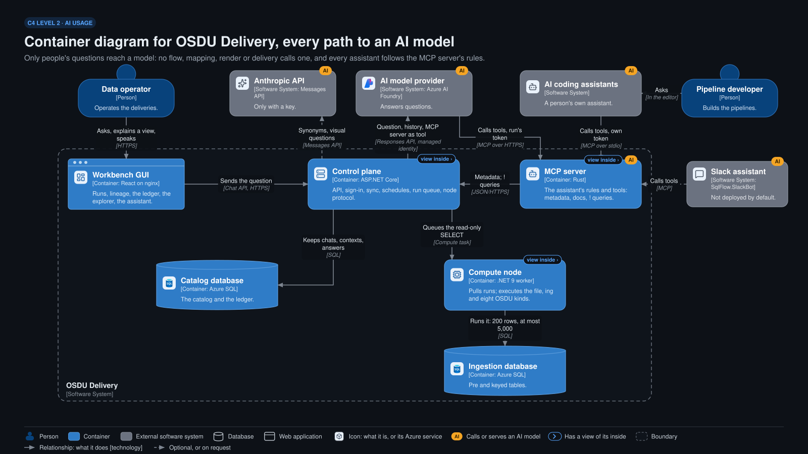

# Container diagram for OSDU Delivery, every path to an AI model

<!-- Generated by tools/c4/render.py from osdu/docs/reference/architecture/c4-model.yaml. Edit the model and render again. -->

[Architecture diagrams](README.md) › [System context](system-context.md) › [Containers](containers.md) › **AI paths** · Zoom in: [Control plane](control-plane.md), [Compute node](compute-node.md), [MCP server](mcp-server.md)

Only people's questions reach a model: no flow, mapping, render or delivery calls one, and every assistant follows the MCP server's rules.

[Light version](svg/ai-usage-light.svg)

## What the view shows

| Element | Kind | Technology | What it is | Reference |
| --- | --- | --- | --- | --- |
| Data operator | Person |  | Triggers and watches runs, follows a record from its source file and row to the OSDU id and version it landed as, releases, redelivers or removes records, reads assertion reports and asks the assistant. | [concepts/gui](../concepts/gui.md) |
| Anthropic API | Software System (AI) | Messages API | Always Anthropic, whatever the assistant's provider: synonym expansion of a ! question (find_similar_questions) and the questions a repository sync generates for report visuals. Both stay off without an Anthropic key. | [concepts/ai-features](../concepts/ai-features.md) |
| AI model provider | Software System (AI) | Azure AI Foundry | The chat model behind the GUI assistant and Explain: a Foundry deployment (gpt-5.1 in the shipped environments), or OpenAI or Anthropic by setting, plus an optional transcription deployment for voice. Off on a fresh deployment; no flow, mapping, render or delivery ever calls a model. | [concepts/ai-features](../concepts/ai-features.md) |
| AI coding assistants | Software System (AI) |  | An assistant a person runs (Claude Code, the VS Code chat, Cursor, Codex). It calls the MCP server with the person's own token, so it can do what that person can do, and what it does is recorded as theirs. | [guides/mcp](../guides/mcp.md) |
| Pipeline developer | Person |  | Writes the estate's flows, mappings, templates, schedules, assertions and AI contexts in VS Code, checks and previews them against the synced estate, and pushes them to the estate repository. | [guides/vscode](../guides/vscode.md) |
| Workbench GUI | Container | React on nginx | SQLFlow's workbench with the module's pages registered through the GUI module contract: pipelines and runs, lineage, the ledger and its records, the explorer of what OSDU holds, assertions, dimensions, inventories, templates, caches and the chat assistant. A static single-page app served by nginx; it calls the control plane's API. | [concepts/gui](../concepts/gui.md) |
| [Control plane](control-plane.md) | Container | ASP.NET Core | SQLFlow's control plane (.NET 9) with DeliveryControlPlaneModule: the REST API (the delivery API under /api/v1/delivery), identity and tokens, the managed git sync, schedules, the run queue and dispatcher, the node protocol, the chat assistant, and the module's background services. It decides what runs and owns the state; it runs no flow itself. | [concepts/control-plane](../concepts/control-plane.md) |
| [MCP server](mcp-server.md) | Container (AI) | Rust | osdu-delivery-mcp, a Model Context Protocol server: SQLFlow's server composed with the delivery module. Every assistant reads its instructions; it answers from metadata, and from data only for a ! question through a read-only query over what an approved AI context opens. It holds no credential: it forwards each caller's token. | [guides/mcp](../guides/mcp.md) |
| Slack assistant | Software System (AI) | SqlFlow.SlackBot | SQLFlow's Slack bot (Socket Mode). It answers through the same gateways and MCP server, under the same fence as the GUI chat, and marks every answer as AI-generated. No template of this product deploys it. | [concepts/ai-features](../concepts/ai-features.md) |
| Catalog database | Container | Azure SQL | OsduDelivery: SQLFlow's catalog (pipelines, runs, schedules, lineage, users, conversations) and, beside it, the osdu schema with its own migrations: the ledger, the audit trail, cache versions, the index of the repository's templates, partitions and the central configuration. | [concepts/database](../concepts/database.md) |
| [Compute node](compute-node.md) | Container | .NET 9 worker | SqlFlow.Delivery.Worker.Host: SQLFlow's worker with the module installed. It takes its work outbound from the control plane, so it can sit next to the data, and reads and writes the ledger in the osdu schema through the catalog's connection. | [cli/worker](../cli/worker.md) |
| Ingestion database | Container | Azure SQL | OsduData: the pre tables a file flow lands its files into, the keyed ingestion tables an ing flow upserts (stamping UpdatedDate_DW) and a delivery flow reads incrementally, and the tables dimension flows build. Snapshot isolation must be on. | [concepts/architecture](../concepts/architecture.md) |

## How they connect

| From | To | What | Technology |
| --- | --- | --- | --- |
| Data operator | Workbench GUI | Asks, explains a view, speaks | HTTPS |
| Pipeline developer | AI coding assistants | Asks | In the editor |
| Workbench GUI | Control plane | Sends the question | Chat API, HTTPS |
| Control plane | Anthropic API | Synonyms, visual questions | Messages API |
| Control plane | AI model provider | Question, history, MCP server as tool | Responses API, managed identity |
| AI model provider | MCP server | Calls tools, run's token | MCP over HTTPS |
| AI coding assistants | MCP server | Calls tools, own token | MCP over stdio |
| Slack assistant | MCP server | Calls tools | MCP |
| MCP server | Control plane | Metadata; ! queries | JSON/HTTPS |
| Control plane | Catalog database | Keeps chats, contexts, answers | SQL |
| Control plane | Compute node | Queues the read-only SELECT | Compute task |
| Compute node | Ingestion database | Runs it: 200 rows, at most 5,000 | SQL |

## Notes

The switches, all off on a fresh deployment: `ControlPlane:Assistant:Enabled` (the GUI assistant and Explain),
`ControlPlane:AiContext:Enabled` (`!` questions and every query a model writes) and
`ControlPlane:AiContext:AutoRun:Enabled` (a saved answer run without a click). The Terraform turns the assistant on
when the MCP server and a Foundry model are both set, and leaves `ai_context_enabled` false.

In estate mode a model is sent metadata only: a record's content, a source row, cached values and a dimension's
values never reach it, and Explain is off on every view of record content. In data mode it is sent the approved
contexts' tables, columns and descriptions and the rows a query returns. A chat run's token is refused on every route
not opened to the assistant, so no chat or Slack run writes to OSDU, the ledger, a mapping or a repository. Every
answer is marked with the model that wrote it ([EU AI Act compatibility](../concepts/eu-ai-act.md)).

---

Previous: [Containers](containers.md) · [Architecture diagrams](README.md) · Next: [Control plane](control-plane.md)
