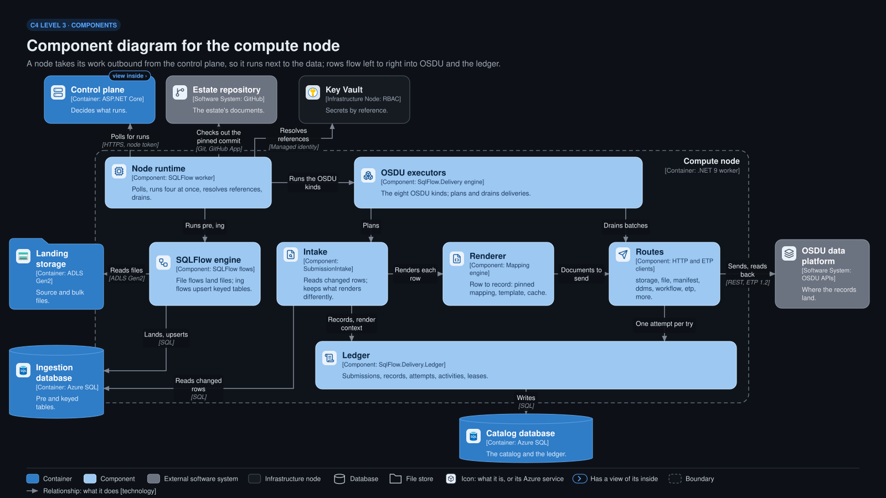

# Component diagram for the compute node

<!-- Generated by tools/c4/render.py from osdu/docs/reference/architecture/c4-model.yaml. Edit the model and render again. -->

[Architecture diagrams](README.md) › [System context](system-context.md) › [Containers](containers.md) › **Compute node** · Zoom in: [Control plane](control-plane.md)

A node takes its work outbound from the control plane, so it runs next to the data; rows flow left to right into OSDU and the ledger.

[Light version](svg/compute-node-light.svg)

## What the view shows

| Element | Kind | Technology | What it is | Reference |
| --- | --- | --- | --- | --- |
| [Control plane](control-plane.md) | Container | ASP.NET Core | SQLFlow's control plane (.NET 9) with DeliveryControlPlaneModule: the REST API (the delivery API under /api/v1/delivery), identity and tokens, the managed git sync, schedules, the run queue and dispatcher, the node protocol, the chat assistant, and the module's background services. It decides what runs and owns the state; it runs no flow itself. | [concepts/control-plane](../concepts/control-plane.md) |
| Estate repository | Software System | GitHub | The estate as YAML and JSON files in git: flows, mappings, templates, cache definitions, schedules, assertions and AI contexts. A run executes the commit the control plane last synced, never a working copy. | [flow/repository](../flow/repository.md) |
| Key Vault | Infrastructure Node | RBAC | osdu-kv-&lt;suffix&gt;, RBAC only. Terraform writes the connection strings (no credential in them); the setup script generates the JWT signing key, the first admin's password and the node token when missing; a person puts in each partition's client secret and the GitHub App's key. | [deploy/README](../../../deploy/README.md) |
| Node runtime | Component | SQLFlow worker | SQLFlow's worker verb with the module installed: polls the control plane with its node token, takes runs and node tasks into its slots (four by default), checks out the commit each run is pinned to, resolves ${env:...} and ${keyvault:...} references with its own identity, and drains running work before it stops. | [cli/worker](../cli/worker.md) |
| OSDU executors | Component | SqlFlow.Delivery engine | One executor per OSDU flow kind (delivery, retrieval, cache, assertion, dimension, inventory, removal, download) behind SQLFlow's DocumentExecutor. A delivery run plans into a submission and work batches, then drains them under leases; a large one fans out a part per 1,000 rows, on up to eight nodes. | [flow/overview](../flow/overview.md) |
| Landing storage | Container | ADLS Gen2 | A storage account with a hierarchical namespace and shared keys off, container landing. Every run is given its location as LANDING_URL (abfss://landing@&lt;account&gt;.dfs.core.windows.net): the source files the file flows land, the bulk payload files deliveries send, and work batch files when a flow writes them there. | [guides/deployment](../guides/deployment.md) |
| SQLFlow engine | Component | SQLFlow flows | SQLFlow's own flows, unchanged: a file flow lands the source files into a pre table as text with FileName_DW and RowNumber_DW and refreshes its typed view; an ing flow upserts the view into a keyed ingestion table and stamps UpdatedDate_DW on every row it changes. | [concepts/overview](../concepts/overview.md) |
| Intake | Component | SubmissionIntake | Reads the rows of the ingestion table and its children whose UpdatedDate_DW moved since the last run (with a short overlap), has each one rendered, and compares its hash with what the ledger last delivered: unchanged records are skipped, changed ones planned into work batches. | [concepts/change-detection](../concepts/change-detection.md) |
| Renderer | Component | Mapping engine | Renders a row through the mapping the flow pins (Name@version), against the template that mapping pins and the version of the partition's cache it reads from the catalog, and mints the record's id from the delivery key, so the same row always becomes the same record. | [flow/mapping](../flow/mapping.md) |
| Routes | Component | HTTP and ETP clients | The protocol of each route: the storage service's batched writes, signed-URL file uploads, dataset registration, manifest ingestion through the workflow service, a DDMS's records and bulk data, workflow runs, the Production DDMS, and ETP 1.2 to the Reservoir DDMS. Legal tags are checked before a run; retries, rate limits and correlation ids on every call; OSDU tokens by client credentials. | [flow/routes](../flow/routes.md) |
| OSDU data platform | Software System | OSDU APIs | A data partition's core services (Storage, Search, Schema, Legal, File, Dataset, Workflow, Entitlements) and its domain data management services (Wellbore, Reservoir over ETP, Production), which hold the delivered records and their bulk data. | [concepts/protocols](../concepts/protocols.md) |
| Ingestion database | Container | Azure SQL | OsduData: the pre tables a file flow lands its files into, the keyed ingestion tables an ing flow upserts (stamping UpdatedDate_DW) and a delivery flow reads incrementally, and the tables dimension flows build. Snapshot isolation must be on. | [concepts/architecture](../concepts/architecture.md) |
| Ledger | Component | SqlFlow.Delivery.Ledger | The only path to the ledger: submissions, records with their source file and row, render context and OSDU id and version, one append-only attempt per try, the audit trail, leases that let nodes share a submission, and the minted ids an unfinished delivery is undone by. | [concepts/ledger](../concepts/ledger.md) |
| Catalog database | Container | Azure SQL | OsduDelivery: SQLFlow's catalog (pipelines, runs, schedules, lineage, users, conversations) and, beside it, the osdu schema with its own migrations: the ledger, the audit trail, cache versions, the index of the repository's templates, partitions and the central configuration. | [concepts/database](../concepts/database.md) |

## How they connect

| From | To | What | Technology |
| --- | --- | --- | --- |
| Node runtime | Control plane | Polls for runs | HTTPS, node token |
| Node runtime | Estate repository | Checks out the pinned commit | Git, GitHub App |
| Node runtime | Key Vault | Resolves references | Managed identity |
| Node runtime | SQLFlow engine | Runs pre, ing |  |
| Node runtime | OSDU executors | Runs the OSDU kinds |  |
| SQLFlow engine | Landing storage | Reads files | ADLS Gen2 |
| SQLFlow engine | Ingestion database | Lands, upserts | SQL |
| OSDU executors | Intake | Plans |  |
| Intake | Ingestion database | Reads changed rows | SQL |
| Intake | Renderer | Renders each row |  |
| OSDU executors | Routes | Drains batches |  |
| Renderer | Routes | Documents to send |  |
| Routes | OSDU data platform | Sends, reads back | REST, ETP 1.2 |
| Intake | Ledger | Records, render context |  |
| Routes | Ledger | One attempt per try |  |
| Ledger | Catalog database | Writes | SQL |

## Notes

A node holds only its identity, the catalog's connection (`SQLFLOW_CATALOG_DB`, for the ledger in the osdu schema)
and its node token; every value a run reads (the ingestion database, the OSDU endpoint, the landing storage) is handed
to the run by the control plane and resolved on the node. A node without `SQLFLOW_CATALOG_DB`, or over an osdu schema
that is missing, behind or ahead of the build, refuses to start. The renderer reads the partition's cache from the
catalog; the routes get OSDU tokens by client credentials from the partition's token endpoint.

---

Previous: [Control plane](control-plane.md) · [Architecture diagrams](README.md) · Next: [MCP server](mcp-server.md)
