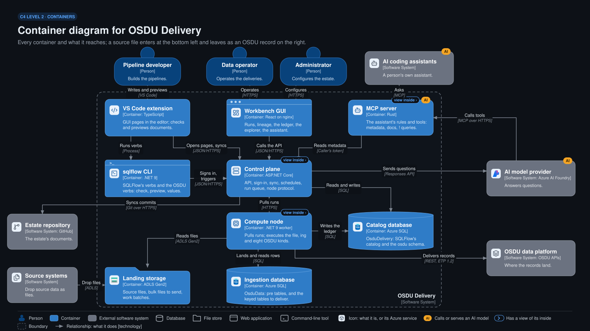

# Container diagram for OSDU Delivery

<!-- Generated by tools/c4/render.py from osdu/docs/reference/architecture/c4-model.yaml. Edit the model and render again. -->

[Architecture diagrams](README.md) › [System context](system-context.md) › **Containers** · Zoom in: [Control plane](control-plane.md), [Compute node](compute-node.md), [MCP server](mcp-server.md)

Every container and what it reaches; a source file enters at the bottom left and leaves as an OSDU record on the right.

[Light version](svg/containers-light.svg)

## What the view shows

| Element | Kind | Technology | What it is | Reference |
| --- | --- | --- | --- | --- |
| Pipeline developer | Person |  | Writes the estate's flows, mappings, templates, schedules, assertions and AI contexts in VS Code, checks and previews them against the synced estate, and pushes them to the estate repository. | [guides/vscode](../guides/vscode.md) |
| Data operator | Person |  | Triggers and watches runs, follows a record from its source file and row to the OSDU id and version it landed as, releases, redelivers or removes records, reads assertion reports and asks the assistant. | [concepts/gui](../concepts/gui.md) |
| Administrator | Person |  | Registers and describes OSDU partitions, sets the central configuration every run resolves with, approves AI contexts, manages users and sets retention on the Maintenance page. | [concepts/authentication-and-identity](../concepts/authentication-and-identity.md) |
| AI coding assistants | Software System (AI) |  | An assistant a person runs (Claude Code, the VS Code chat, Cursor, Codex). It calls the MCP server with the person's own token, so it can do what that person can do, and what it does is recorded as theirs. | [guides/mcp](../guides/mcp.md) |
| VS Code extension | Container | TypeScript | Makes the editor the place a pipeline is developed: the GUI's pages in tabs, completion and checks for every flow, mapping and template, a mapping's preview from the open file, and one sign-in it shares with the command line and the MCP server. | [guides/vscode](../guides/vscode.md) |
| Workbench GUI | Container | React on nginx | SQLFlow's workbench with the module's pages registered through the GUI module contract: pipelines and runs, lineage, the ledger and its records, the explorer of what OSDU holds, assertions, dimensions, inventories, templates, caches and the chat assistant. A static single-page app served by nginx; it calls the control plane's API. | [concepts/gui](../concepts/gui.md) |
| [MCP server](mcp-server.md) | Container (AI) | Rust | osdu-delivery-mcp, a Model Context Protocol server: SQLFlow's server composed with the delivery module. Every assistant reads its instructions; it answers from metadata, and from data only for a ! question through a read-only query over what an approved AI context opens. It holds no credential: it forwards each caller's token. | [guides/mcp](../guides/mcp.md) |
| sqlflow CLI | Container | .NET 9 | The sqlflow command line (SqlFlow.Delivery.Cli.Host): every SQLFlow verb plus the OSDU verbs (check, preview, values, records, config, partition, cache, template and more). It checks and previews the working copy, drives the control plane, and can run a flow locally through the same executors a node uses. | [cli/check](../cli/check.md) |
| [Control plane](control-plane.md) | Container | ASP.NET Core | SQLFlow's control plane (.NET 9) with DeliveryControlPlaneModule: the REST API (the delivery API under /api/v1/delivery), identity and tokens, the managed git sync, schedules, the run queue and dispatcher, the node protocol, the chat assistant, and the module's background services. It decides what runs and owns the state; it runs no flow itself. | [concepts/control-plane](../concepts/control-plane.md) |
| AI model provider | Software System (AI) | Azure AI Foundry | The chat model behind the GUI assistant and Explain: a Foundry deployment (gpt-5.1 in the shipped environments), or OpenAI or Anthropic by setting, plus an optional transcription deployment for voice. Off on a fresh deployment; no flow, mapping, render or delivery ever calls a model. | [concepts/ai-features](../concepts/ai-features.md) |
| Estate repository | Software System | GitHub | The estate as YAML and JSON files in git: flows, mappings, templates, cache definitions, schedules, assertions and AI contexts. A run executes the commit the control plane last synced, never a working copy. | [flow/repository](../flow/repository.md) |
| [Compute node](compute-node.md) | Container | .NET 9 worker | SqlFlow.Delivery.Worker.Host: SQLFlow's worker with the module installed. It takes its work outbound from the control plane, so it can sit next to the data, and reads and writes the ledger in the osdu schema through the catalog's connection. | [cli/worker](../cli/worker.md) |
| Catalog database | Container | Azure SQL | OsduDelivery: SQLFlow's catalog (pipelines, runs, schedules, lineage, users, conversations) and, beside it, the osdu schema with its own migrations: the ledger, the audit trail, cache versions, the index of the repository's templates, partitions and the central configuration. | [concepts/database](../concepts/database.md) |
| OSDU data platform | Software System | OSDU APIs | A data partition's core services (Storage, Search, Schema, Legal, File, Dataset, Workflow, Entitlements) and its domain data management services (Wellbore, Reservoir over ETP, Production), which hold the delivered records and their bulk data. | [concepts/protocols](../concepts/protocols.md) |
| Source systems | Software System |  | Where the data starts. Upstream applications and jobs drop files (CSV, JSON, Parquet, LAS and others) into the landing storage, or hold the data in a database a flow reads. | [guides/getting-started](../guides/getting-started.md) |
| Landing storage | Container | ADLS Gen2 | A storage account with a hierarchical namespace and shared keys off, container landing. Every run is given its location as LANDING_URL (abfss://landing@&lt;account&gt;.dfs.core.windows.net): the source files the file flows land, the bulk payload files deliveries send, and work batch files when a flow writes them there. | [guides/deployment](../guides/deployment.md) |
| Ingestion database | Container | Azure SQL | OsduData: the pre tables a file flow lands its files into, the keyed ingestion tables an ing flow upserts (stamping UpdatedDate_DW) and a delivery flow reads incrementally, and the tables dimension flows build. Snapshot isolation must be on. | [concepts/architecture](../concepts/architecture.md) |

## How they connect

| From | To | What | Technology |
| --- | --- | --- | --- |
| Pipeline developer | VS Code extension | Writes and previews | VS Code |
| Data operator | Workbench GUI | Operates | HTTPS |
| Administrator | Workbench GUI | Configures | HTTPS |
| AI coding assistants | MCP server | Asks | MCP |
| VS Code extension | sqlflow CLI | Runs verbs | Process |
| VS Code extension | Control plane | Opens pages, syncs | JSON/HTTPS |
| sqlflow CLI | Control plane | Signs in, triggers | JSON/HTTPS |
| Workbench GUI | Control plane | Calls the API | JSON/HTTPS |
| MCP server | Control plane | Reads metadata | Caller's token |
| Control plane | AI model provider | Sends questions | Responses API |
| AI model provider | MCP server | Calls tools | MCP over HTTPS |
| Control plane | Catalog database | Reads and writes | SQL |
| Control plane | Estate repository | Syncs commits | Git over HTTPS |
| Compute node | Control plane | Pulls runs | HTTPS |
| Compute node | Catalog database | Writes the ledger | SQL |
| Compute node | Landing storage | Reads files | ADLS Gen2 |
| Compute node | Ingestion database | Lands and reads rows | SQL |
| Compute node | OSDU data platform | Delivers records | REST, ETP 1.2 |
| Source systems | Landing storage | Drop files | ADLS |

## Notes

Sign-in runs through Microsoft Entra ID for the GUI, the editor and the command line, and the control plane and the
nodes reach Azure with managed identities: both are drawn in the [deployment view](deployment-azure.md). The
control plane also reads OSDU itself, for the explorer, a record read back and a target probe, and reads the
ingestion database for previews ([control plane components](control-plane.md)). A node checks out the commit its run
is pinned to ([git integration](git-integration.md)).

---

Previous: [System context](system-context.md) · [Architecture diagrams](README.md) · Next: [AI paths](ai-usage.md)
