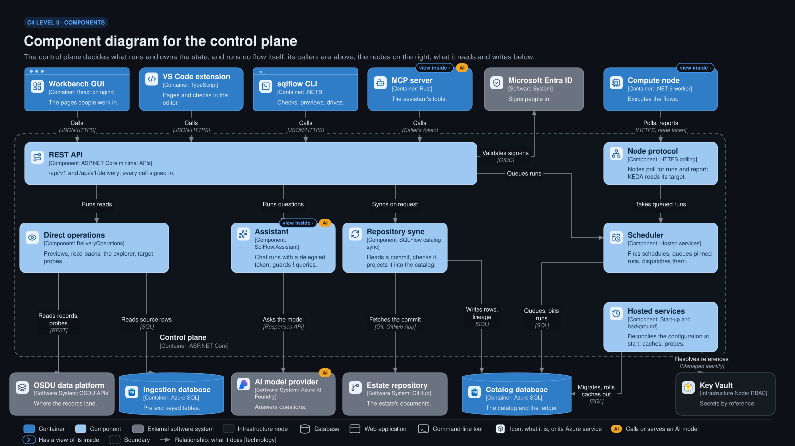

# Component diagram for the control plane

<!-- Generated by tools/c4/render.py from osdu/docs/reference/architecture/c4-model.yaml. Edit the model and render again. -->

[Architecture diagrams](README.md) › [System context](system-context.md) › [Containers](containers.md) › **Control plane** · Zoom in: [AI paths](ai-usage.md), [Compute node](compute-node.md), [MCP server](mcp-server.md)

The control plane decides what runs and owns the state, and runs no flow itself: its callers are above, the nodes on the right, what it reads and writes below.

[Light version](svg/control-plane-light.svg)

## What the view shows

| Element | Kind | Technology | What it is | Reference |
| --- | --- | --- | --- | --- |
| Workbench GUI | Container | React on nginx | SQLFlow's workbench with the module's pages registered through the GUI module contract: pipelines and runs, lineage, the ledger and its records, the explorer of what OSDU holds, assertions, dimensions, inventories, templates, caches and the chat assistant. A static single-page app served by nginx; it calls the control plane's API. | [concepts/gui](../concepts/gui.md) |
| VS Code extension | Container | TypeScript | Makes the editor the place a pipeline is developed: the GUI's pages in tabs, completion and checks for every flow, mapping and template, a mapping's preview from the open file, and one sign-in it shares with the command line and the MCP server. | [guides/vscode](../guides/vscode.md) |
| sqlflow CLI | Container | .NET 9 | The sqlflow command line (SqlFlow.Delivery.Cli.Host): every SQLFlow verb plus the OSDU verbs (check, preview, values, records, config, partition, cache, template and more). It checks and previews the working copy, drives the control plane, and can run a flow locally through the same executors a node uses. | [cli/check](../cli/check.md) |
| [MCP server](mcp-server.md) | Container (AI) | Rust | osdu-delivery-mcp, a Model Context Protocol server: SQLFlow's server composed with the delivery module. Every assistant reads its instructions; it answers from metadata, and from data only for a ! question through a read-only query over what an approved AI context opens. It holds no credential: it forwards each caller's token. | [guides/mcp](../guides/mcp.md) |
| Microsoft Entra ID | Software System |  | Signs people in to the GUI, the editor and the command line (OpenID Connect) through the app registration's one role, SqlFlow.User, with assignment required, and issues the managed identity and client-credential tokens (OAuth 2.0) the services use for Azure and OSDU. | [concepts/authentication-and-identity](../concepts/authentication-and-identity.md) |
| [Compute node](compute-node.md) | Container | .NET 9 worker | SqlFlow.Delivery.Worker.Host: SQLFlow's worker with the module installed. It takes its work outbound from the control plane, so it can sit next to the data, and reads and writes the ledger in the osdu schema through the catalog's connection. | [cli/worker](../cli/worker.md) |
| REST API | Component | ASP.NET Core minimal APIs | SQLFlow's routes (pipelines, runs, schedules, lineage, repositories, users, chat) and the module's under /api/v1/delivery. Every call is authenticated: Entra single sign-on, local login, the device grant, personal access tokens, node tokens and an assistant run's delegated token. read, operate and author admit any signed-in user; admin checks the scope. | [concepts/api](../concepts/api.md) |
| Node protocol | Component | HTTPS polling | /api/v1/node: a node with a node-scope token polls for work, fetches the flow version its run is pinned to, streams progress and posts results. /api/v1/node/scale-target answers KEDA with max(demand, the pool's floor, a manual setting) plus busy nodes, so a pool never shrinks under work. | [cli/worker](../../../../sqlflow/docs/reference/cli/worker.md) |
| Direct operations | Component | DeliveryOperations | Run in the control plane's process while the request waits: a mapping's preview, a record read back from OSDU, its source rows, a scope's values, the explorer's reads of what OSDU holds, and a probe of a flow's target. A read writes no activity; a probe is recorded. | [concepts/control-plane](../concepts/control-plane.md) |
| [Assistant](ai-usage.md) | Component (AI) | SqlFlow.Assistant | The assistant gateway and the AI context guard: runs each chat or Explain question under a token delegated for that run, with the MCP server as the model's tool, and opens to a ! question only the columns approved AI contexts name. | [concepts/ai-features](../concepts/ai-features.md) |
| Repository sync | Component | SQLFlow catalog sync | The managed git sync: reads the commit a trigger names, the branch's tip on a person's request, or every interval when auto sync is on; validates every document; writes the catalog's rows and, through DeliveryCatalogSync, the module's mappings, cache definitions and interfaces; recomputes lineage. It only moves forward. | [concepts/repository-auto-sync](../../../../sqlflow/docs/reference/concepts/repository-auto-sync.md) |
| Scheduler | Component | Hosted services | Fires the schedules the estate declares (in order within a schedule), queues runs each pinned to the commit last synced, splits a large delivery into parts on nodes of their own, and dispatches under a lease, which is why the control plane runs as one replica. | [concepts/control-plane](../../../../sqlflow/docs/reference/concepts/control-plane.md) |
| Hosted services | Component | Start-up and background | At every start, one ordered, repeatable pass: catalog then osdu migrations, the initial admin, the node credential, repositories, partitions, run values and triggers (GET /api/v1/bootstrap). Then the module's services: cache rollout and warm-up, the scheduled target probe, the OSDU data definitions copy, duplicate-check sweeps, ledger moves of renamed flows. | [concepts/control-plane](../concepts/control-plane.md) |
| OSDU data platform | Software System | OSDU APIs | A data partition's core services (Storage, Search, Schema, Legal, File, Dataset, Workflow, Entitlements) and its domain data management services (Wellbore, Reservoir over ETP, Production), which hold the delivered records and their bulk data. | [concepts/protocols](../concepts/protocols.md) |
| Ingestion database | Container | Azure SQL | OsduData: the pre tables a file flow lands its files into, the keyed ingestion tables an ing flow upserts (stamping UpdatedDate_DW) and a delivery flow reads incrementally, and the tables dimension flows build. Snapshot isolation must be on. | [concepts/architecture](../concepts/architecture.md) |
| AI model provider | Software System (AI) | Azure AI Foundry | The chat model behind the GUI assistant and Explain: a Foundry deployment (gpt-5.1 in the shipped environments), or OpenAI or Anthropic by setting, plus an optional transcription deployment for voice. Off on a fresh deployment; no flow, mapping, render or delivery ever calls a model. | [concepts/ai-features](../concepts/ai-features.md) |
| Estate repository | Software System | GitHub | The estate as YAML and JSON files in git: flows, mappings, templates, cache definitions, schedules, assertions and AI contexts. A run executes the commit the control plane last synced, never a working copy. | [flow/repository](../flow/repository.md) |
| Catalog database | Container | Azure SQL | OsduDelivery: SQLFlow's catalog (pipelines, runs, schedules, lineage, users, conversations) and, beside it, the osdu schema with its own migrations: the ledger, the audit trail, cache versions, the index of the repository's templates, partitions and the central configuration. | [concepts/database](../concepts/database.md) |
| Key Vault | Infrastructure Node | RBAC | osdu-kv-&lt;suffix&gt;, RBAC only. Terraform writes the connection strings (no credential in them); the setup script generates the JWT signing key, the first admin's password and the node token when missing; a person puts in each partition's client secret and the GitHub App's key. | [deploy/README](../../../deploy/README.md) |

## How they connect

| From | To | What | Technology |
| --- | --- | --- | --- |
| Workbench GUI | REST API | Calls | JSON/HTTPS |
| VS Code extension | REST API | Calls | JSON/HTTPS |
| sqlflow CLI | REST API | Calls | JSON/HTTPS |
| MCP server | REST API | Calls | Caller's token |
| Compute node | Node protocol | Polls, reports | HTTPS, node token |
| REST API | Microsoft Entra ID | Validates sign-ins | OIDC |
| REST API | Direct operations | Runs reads |  |
| REST API | Assistant | Runs questions |  |
| REST API | Repository sync | Syncs on request |  |
| REST API | Scheduler | Queues runs |  |
| Node protocol | Scheduler | Takes queued runs |  |
| Direct operations | OSDU data platform | Reads records, probes | REST |
| Direct operations | Ingestion database | Reads source rows | SQL |
| Assistant | AI model provider | Asks the model | Responses API |
| Repository sync | Estate repository | Fetches the commit | Git, GitHub App |
| Repository sync | Catalog database | Writes rows, lineage | SQL |
| Scheduler | Catalog database | Queues, pins runs | SQL |
| Hosted services | Catalog database | Migrates, rolls caches out | SQL |
| Hosted services | Key Vault | Resolves references | Managed identity |

## Notes

The control plane runs as one replica, because the dispatcher hands runs out under a lease. The module's background
services run beside SQLFlow's: the cache update rollout (`Osdu:CacheRollout`) and warm-up (`Osdu:CacheWarmup`), both
on by default, the scheduled target probe (`Osdu:TargetProbe`, off by default), the OSDU data definitions copy the
Templates page browses, the duplicate-check sweep and the ledger moves of renamed flows. Every run of an OSDU kind it
queues carries the central configuration, so a flow's `${env:NAME}` resolves from one place before it falls back to
the node. The assistant's two components are drawn in the [AI usage view](ai-usage.md) and the
[question](question.md) it answers.

---

Previous: [AI paths](ai-usage.md) · [Architecture diagrams](README.md) · Next: [Compute node](compute-node.md)
