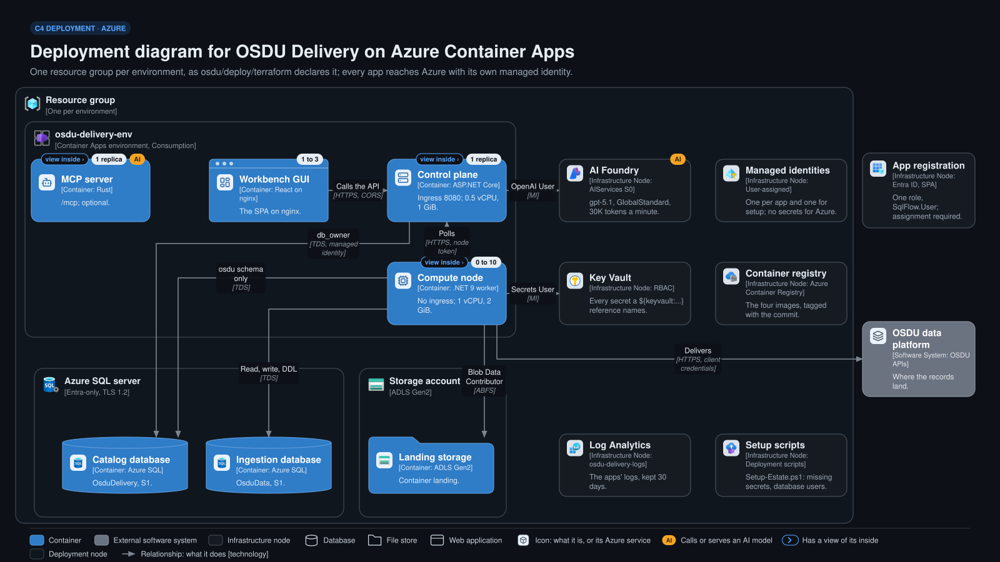

# Deployment diagram for OSDU Delivery on Azure Container Apps

<!-- Generated by tools/c4/render.py from osdu/docs/reference/architecture/c4-model.yaml. Edit the model and render again. -->

[Architecture diagrams](README.md) › [System context](system-context.md) › [Containers](containers.md) › **Azure deployment** · Zoom in: [Control plane](control-plane.md), [Compute node](compute-node.md), [MCP server](mcp-server.md)

One resource group per environment, as osdu/deploy/terraform declares it; every app reaches Azure with its own managed identity.

[Light version](svg/deployment-azure-light.svg)

## What the view shows

| Element | Kind | Technology | What it is | Reference |
| --- | --- | --- | --- | --- |
| [MCP server](mcp-server.md) | Container (AI) | Rust | osdu-delivery-mcp, a Model Context Protocol server: SQLFlow's server composed with the delivery module. Every assistant reads its instructions; it answers from metadata, and from data only for a ! question through a read-only query over what an approved AI context opens. It holds no credential: it forwards each caller's token. | [guides/mcp](../guides/mcp.md) |
| Workbench GUI | Container | React on nginx | SQLFlow's workbench with the module's pages registered through the GUI module contract: pipelines and runs, lineage, the ledger and its records, the explorer of what OSDU holds, assertions, dimensions, inventories, templates, caches and the chat assistant. A static single-page app served by nginx; it calls the control plane's API. | [concepts/gui](../concepts/gui.md) |
| [Control plane](control-plane.md) | Container | ASP.NET Core | SQLFlow's control plane (.NET 9) with DeliveryControlPlaneModule: the REST API (the delivery API under /api/v1/delivery), identity and tokens, the managed git sync, schedules, the run queue and dispatcher, the node protocol, the chat assistant, and the module's background services. It decides what runs and owns the state; it runs no flow itself. | [concepts/control-plane](../concepts/control-plane.md) |
| [Compute node](compute-node.md) | Container | .NET 9 worker | SqlFlow.Delivery.Worker.Host: SQLFlow's worker with the module installed. It takes its work outbound from the control plane, so it can sit next to the data, and reads and writes the ledger in the osdu schema through the catalog's connection. | [cli/worker](../cli/worker.md) |
| Catalog database | Container | Azure SQL | OsduDelivery: SQLFlow's catalog (pipelines, runs, schedules, lineage, users, conversations) and, beside it, the osdu schema with its own migrations: the ledger, the audit trail, cache versions, the index of the repository's templates, partitions and the central configuration. | [concepts/database](../concepts/database.md) |
| Ingestion database | Container | Azure SQL | OsduData: the pre tables a file flow lands its files into, the keyed ingestion tables an ing flow upserts (stamping UpdatedDate_DW) and a delivery flow reads incrementally, and the tables dimension flows build. Snapshot isolation must be on. | [concepts/architecture](../concepts/architecture.md) |
| Landing storage | Container | ADLS Gen2 | A storage account with a hierarchical namespace and shared keys off, container landing. Every run is given its location as LANDING_URL (abfss://landing@&lt;account&gt;.dfs.core.windows.net): the source files the file flows land, the bulk payload files deliveries send, and work batch files when a flow writes them there. | [guides/deployment](../guides/deployment.md) |
| AI Foundry | Infrastructure Node (AI) | AIServices S0 | Created only when ai_foundry_name is set: an AIServices account, the project osdu-delivery and a model deployment (gpt-5.1 in the shipped environments), with an optional transcription deployment. Where prompts are processed follows the SKU: GlobalStandard, DataZoneStandard (EU or US) or Standard (the account's region). | [concepts/ai-features](../concepts/ai-features.md) |
| Key Vault | Infrastructure Node | RBAC | osdu-kv-&lt;suffix&gt;, RBAC only. Terraform writes the connection strings (no credential in them); the setup script generates the JWT signing key, the first admin's password and the node token when missing; a person puts in each partition's client secret and the GitHub App's key. | [deploy/README](../../../deploy/README.md) |
| Log Analytics | Infrastructure Node | osdu-delivery-logs | The apps' logs, kept 30 days. | [deploy/README](../../../deploy/README.md) |
| Managed identities | Infrastructure Node | User-assigned | osdu-delivery-control-plane-id, -worker-id, -gui-id and -mcp-id, and osdu-delivery-setup, which no app runs as. Each app reaches SQL, the vault, the storage and the model keylessly with its own identity. | [deploy/README](../../../deploy/README.md) |
| Container registry | Infrastructure Node | Azure Container Registry | Created by hand once per environment, read by the Terraform; every app pulls its image with AcrPull. | [deploy/README](../../../deploy/README.md) |
| Setup scripts | Infrastructure Node | Deployment scripts | Two AzurePowerShell deployment scripts, run as the setup identity on every apply: one generates the secrets the vault lacks, the other creates the apps' database users and grants. | [deploy/README](../../../deploy/README.md) |
| App registration | Infrastructure Node | Entra ID, SPA | OSDU Delivery: a single-page app registration whose redirect URI is the GUI's address, with one app role, SqlFlow.User, and assignment required, so nobody signs in until a group or person is assigned. | [concepts/authentication-and-identity](../concepts/authentication-and-identity.md) |
| OSDU data platform | Software System | OSDU APIs | A data partition's core services (Storage, Search, Schema, Legal, File, Dataset, Workflow, Entitlements) and its domain data management services (Wellbore, Reservoir over ETP, Production), which hold the delivered records and their bulk data. | [concepts/protocols](../concepts/protocols.md) |

## How they connect

| From | To | What | Technology |
| --- | --- | --- | --- |
| Workbench GUI | Control plane | Calls the API | HTTPS, CORS |
| Compute node | Control plane | Polls | HTTPS, node token |
| Control plane | Catalog database | db_owner | TDS, managed identity |
| Compute node | Catalog database | osdu schema only | TDS |
| Compute node | Ingestion database | Read, write, DDL | TDS |
| Compute node | Landing storage | Blob Data Contributor | ABFS |
| Control plane | AI Foundry | OpenAI User | MI |
| Compute node | Key Vault | Secrets User | MI |
| Compute node | OSDU data platform | Delivers | HTTPS, client credentials |

## Notes

**The apps.** `osdu-delivery-control-plane`: external ingress on 8080, exactly one replica (0.5 vCPU, 1 GiB), the
worker off inside it. `osdu-delivery-worker`: no ingress at all, 0 to 10 replicas (1 vCPU, 2 GiB) on KEDA's
metrics-api rule against `/api/v1/node/scale-target`, 600 seconds to finish a run on scale-in. `osdu-delivery-gui`:
nginx serving the single-page app, 1 to 3 replicas on 200 concurrent requests. `osdu-delivery-mcp`: optional
(`mcp_enabled`), exactly one replica, since MCP sessions live in its memory. The GUI is its own origin; the control
plane allows it by CORS. A node reaches the control plane at its external address. The control plane reads the vault
too (Key Vault Secrets User), and every app writes its logs to Log Analytics through the environment.

**Who may reach what.** The grants the Terraform and its setup script give:

| Identity | Grants |
| --- | --- |
| Setup (`osdu-delivery-setup`) | Key Vault Secrets Officer; the SQL server's Entra administrator. No app runs as it |
| Control plane | Key Vault Secrets User, AcrPull, Storage Blob Data Reader on the landing account, `db_owner` on `OsduDelivery`, `db_datareader` on `OsduData`, Cognitive Services User (and OpenAI User with the assistant on) |
| Worker | Key Vault Secrets User, AcrPull, Storage Blob Data Contributor, on `OsduDelivery` the `osdu` schema only (select, insert, update, delete, execute, alter, references, create table and view), on `OsduData` `db_ddladmin`, `db_datareader` and `db_datawriter`, Cognitive Services User |
| GUI, MCP server | AcrPull |
| The estate's SQL administrators | `db_owner` on every database |

**Networking.** The SQL server takes Entra authentication only and allows Azure services (0.0.0.0), since the
consumption plan has no fixed outbound address; to close it, run the environment in a VNet
(`infrastructure_subnet_id`) and reach SQL over a private endpoint. The landing account has shared keys off. Created
by hand once: the resource group, the registry and the Terraform state account. Put in the vault by hand: each
partition's client secret and the GitHub App's key.

---

Previous: [A commit synced](git-integration.md) · [Architecture diagrams](README.md)
