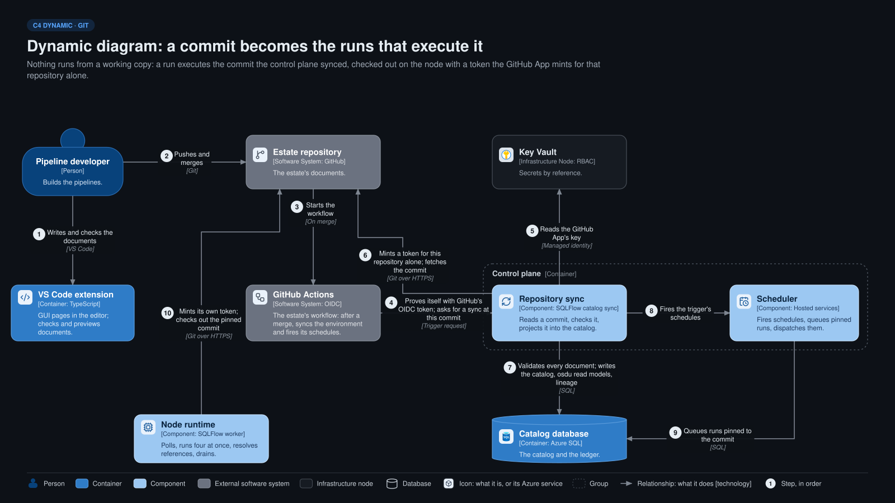

# Dynamic diagram: a commit becomes the runs that execute it

<!-- Generated by tools/c4/render.py from osdu/docs/reference/architecture/c4-model.yaml. Edit the model and render again. -->

[Architecture diagrams](README.md) › [System context](system-context.md) › [Containers](containers.md) › **A commit synced**

Nothing runs from a working copy: a run executes the commit the control plane synced, checked out on the node with a token the GitHub App mints for that repository alone.

[Light version](svg/git-integration-light.svg)

## The steps

| Step | From | To | What happens |
| --- | --- | --- | --- |
| 1 | Pipeline developer | VS Code extension | The developer edits flows, mappings and templates with the language engine's checks, and previews a mapping from the open file. (VS Code) |
| 2 | Pipeline developer | Estate repository | A pull request merges into the branch the environment syncs. (Git) |
| 3 | Estate repository | GitHub Actions | The estate repository's workflow starts after the merge. (On merge) |
| 4 | GitHub Actions | Repository sync | The job exchanges the OIDC token GitHub minted for it, for the control plane's URL as audience, for a short-lived credential (nothing secret is stored), and makes a trigger request: sync this repository at this commit, then fire these schedules. (Trigger request) |
| 5 | Repository sync | Key Vault | The sync reads the GitHub App's private key from the vault with the control plane's own identity. (Managed identity) |
| 6 | Repository sync | Estate repository | It mints a short-lived installation token for that one repository and fetches the commit; a sync only moves forward, never to a commit the held one already contains. (Git over HTTPS) |
| 7 | Repository sync | Catalog database | Every document is validated; the catalog's rows, the module's mappings, cache definitions and interfaces, and the lineage are written in the catalog's transaction. (SQL) |
| 8 | Repository sync | Scheduler | Once the sync has committed, the schedules the trigger names fire. |
| 9 | Scheduler | Catalog database | Each run is queued pinned to the commit just synced, and nodes take them over the node protocol. (SQL) |
| 10 | Node runtime | Estate repository | The node that takes a run mints its own installation token with its own identity and checks out exactly the commit the run is pinned to. (Git over HTTPS) |

## What the view shows

| Element | Kind | Technology | What it is | Reference |
| --- | --- | --- | --- | --- |
| Pipeline developer | Person |  | Writes the estate's flows, mappings, templates, schedules, assertions and AI contexts in VS Code, checks and previews them against the synced estate, and pushes them to the estate repository. | [guides/vscode](../guides/vscode.md) |
| Estate repository | Software System | GitHub | The estate as YAML and JSON files in git: flows, mappings, templates, cache definitions, schedules, assertions and AI contexts. A run executes the commit the control plane last synced, never a working copy. | [flow/repository](../flow/repository.md) |
| Key Vault | Infrastructure Node | RBAC | osdu-kv-&lt;suffix&gt;, RBAC only. Terraform writes the connection strings (no credential in them); the setup script generates the JWT signing key, the first admin's password and the node token when missing; a person puts in each partition's client secret and the GitHub App's key. | [deploy/README](../../../deploy/README.md) |
| VS Code extension | Container | TypeScript | Makes the editor the place a pipeline is developed: the GUI's pages in tabs, completion and checks for every flow, mapping and template, a mapping's preview from the open file, and one sign-in it shares with the command line and the MCP server. | [guides/vscode](../guides/vscode.md) |
| GitHub Actions | Software System | OIDC | A job proves who it is with the OpenID Connect token GitHub mints for it, for the audience the control plane names, and makes trigger requests: sync this repository at this commit, then fire these schedules. Nothing secret is stored. | [concepts/external-triggers](../../../../sqlflow/docs/reference/concepts/external-triggers.md) |
| Repository sync | Component | SQLFlow catalog sync | The managed git sync: reads the commit a trigger names, the branch's tip on a person's request, or every interval when auto sync is on; validates every document; writes the catalog's rows and, through DeliveryCatalogSync, the module's mappings, cache definitions and interfaces; recomputes lineage. It only moves forward. | [concepts/repository-auto-sync](../../../../sqlflow/docs/reference/concepts/repository-auto-sync.md) |
| Scheduler | Component | Hosted services | Fires the schedules the estate declares (in order within a schedule), queues runs each pinned to the commit last synced, splits a large delivery into parts on nodes of their own, and dispatches under a lease, which is why the control plane runs as one replica. | [concepts/control-plane](../../../../sqlflow/docs/reference/concepts/control-plane.md) |
| Node runtime | Component | SQLFlow worker | SQLFlow's worker verb with the module installed: polls the control plane with its node token, takes runs and node tasks into its slots (four by default), checks out the commit each run is pinned to, resolves ${env:...} and ${keyvault:...} references with its own identity, and drains running work before it stops. | [cli/worker](../cli/worker.md) |
| Catalog database | Container | Azure SQL | OsduDelivery: SQLFlow's catalog (pipelines, runs, schedules, lineage, users, conversations) and, beside it, the osdu schema with its own migrations: the ledger, the audit trail, cache versions, the index of the repository's templates, partitions and the central configuration. | [concepts/database](../concepts/database.md) |

## Notes

With auto sync on, the control plane also syncs the tip of the branch every interval; several environments behind one
repository turn it off, so a merge reaches each one only when its own trigger, gated by its GitHub environment's
reviewers, asks ([automatic sync](../../../../sqlflow/docs/reference/concepts/repository-auto-sync.md)). A person can
sync from the GUI, the editor or `sqlflow repos sync`; the GUI first confirms the commit it holds. Without a GitHub
App, a repository names a fine-grained token kept in the vault. The product's own repository builds and deploys
through `.github/workflows/ci.yml` and `deploy.yml` with an OIDC identity per GitHub environment
([deployment](../guides/deployment.md)).

---

Previous: [A question answered](question.md) · [Architecture diagrams](README.md) · Next: [Azure deployment](deployment-azure.md)
