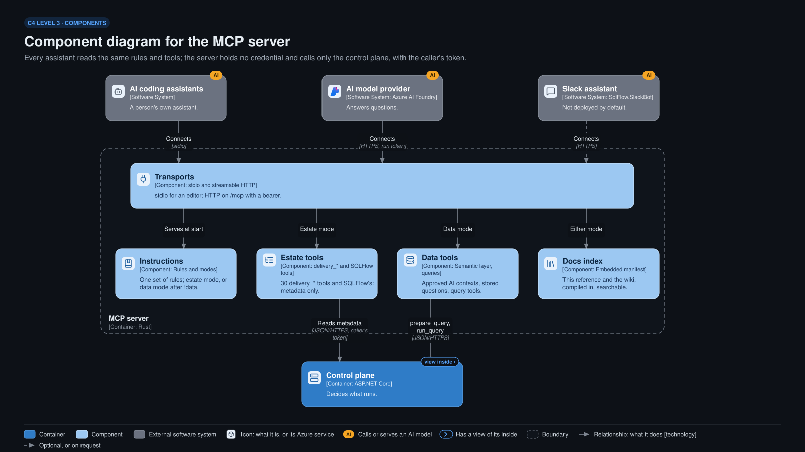

# Component diagram for the MCP server

<!-- Generated by tools/c4/render.py from osdu/docs/reference/architecture/c4-model.yaml. Edit the model and render again. -->

[Architecture diagrams](README.md) › [System context](system-context.md) › [Containers](containers.md) › **MCP server** · Zoom in: [Control plane](control-plane.md)

Every assistant reads the same rules and tools; the server holds no credential and calls only the control plane, with the caller's token.

[Light version](svg/mcp-server-light.svg)

## What the view shows

| Element | Kind | Technology | What it is | Reference |
| --- | --- | --- | --- | --- |
| AI coding assistants | Software System (AI) |  | An assistant a person runs (Claude Code, the VS Code chat, Cursor, Codex). It calls the MCP server with the person's own token, so it can do what that person can do, and what it does is recorded as theirs. | [guides/mcp](../guides/mcp.md) |
| AI model provider | Software System (AI) | Azure AI Foundry | The chat model behind the GUI assistant and Explain: a Foundry deployment (gpt-5.1 in the shipped environments), or OpenAI or Anthropic by setting, plus an optional transcription deployment for voice. Off on a fresh deployment; no flow, mapping, render or delivery ever calls a model. | [concepts/ai-features](../concepts/ai-features.md) |
| Slack assistant | Software System (AI) | SqlFlow.SlackBot | SQLFlow's Slack bot (Socket Mode). It answers through the same gateways and MCP server, under the same fence as the GUI chat, and marks every answer as AI-generated. No template of this product deploys it. | [concepts/ai-features](../concepts/ai-features.md) |
| Transports | Component | stdio and streamable HTTP | stdio, started by the editor with the person's stored sign-in; or osdu-delivery-mcp http, streamable HTTP on /mcp, where every request carries Authorization: Bearer, checked with GET /api/v1/me before any tool runs. Over HTTP it holds no credential of its own. | [guides/mcp](../guides/mcp.md) |
| Instructions | Component | Rules and modes | The rules every client reads at initialize: what ! means, how follow-ups are answered, where a person acts. Estate mode holds the metadata tools; data mode, entered by !data or a bare !, holds only the semantic layer, stored questions and query tools; !exit returns. A session refuses the other mode's tools. | [guides/mcp](../guides/mcp.md) |
| Estate tools | Component | delivery_* and SQLFlow tools | A record's custody state, OSDU id and version, attempts and errors, source file and row, who acted and when; flows, mappings, templates, caches, assertions, dimensions; counts and health. Never a record's content, a source row, cached values or a dimension's values. Seven SQLFlow tools that profile data are withheld. | [guides/mcp](../guides/mcp.md) |
| Data tools | Component | Semantic layer, queries | get_semantic_layer and its search, find_similar_questions with the grounding to answer from, prepare_query (shown to the person), run_query with its plan token, auto_run_trusted_match for a saved answer a person confirmed, and confirm_question for a verdict. | [guides/mcp](../guides/mcp.md) |
| Docs index | Component | Embedded manifest | build.rs embeds every page the manifest lists, OSDU Delivery's reference and wiki and SQLFlow's, so search_docs, get_doc and related_docs answer without the network; the key census teaches the flow language. | [reference/README](../README.md) |
| [Control plane](control-plane.md) | Container | ASP.NET Core | SQLFlow's control plane (.NET 9) with DeliveryControlPlaneModule: the REST API (the delivery API under /api/v1/delivery), identity and tokens, the managed git sync, schedules, the run queue and dispatcher, the node protocol, the chat assistant, and the module's background services. It decides what runs and owns the state; it runs no flow itself. | [concepts/control-plane](../concepts/control-plane.md) |

## How they connect

| From | To | What | Technology |
| --- | --- | --- | --- |
| AI coding assistants | Transports | Connects | stdio |
| AI model provider | Transports | Connects | HTTPS, run token |
| Slack assistant | Transports | Connects | HTTPS |
| Transports | Instructions | Serves at start |  |
| Transports | Estate tools | Estate mode |  |
| Transports | Data tools | Data mode |  |
| Transports | Docs index | Either mode |  |
| Estate tools | Control plane | Reads metadata | JSON/HTTPS, caller's token |
| Data tools | Control plane | prepare_query, run_query | JSON/HTTPS |

## Notes

Over HTTP every request to `/mcp` carries `Authorization: Bearer`, checked with the control plane's `GET /api/v1/me`
before any tool runs, and forwarded with every call, so the control plane authorizes it as it authorizes the GUI; a
missing bearer never falls back to a stored one. No `delivery_*` tool returns a record's content, a source row, cached
values or a dimension's values, or removes records from OSDU. `WITHHELD` in `src/lib.rs` keeps out seven SQLFlow tools
that profile, sample or probe a datasource, and the tests fail when SQLFlow adds a tool not yet offered or withheld.

---

Previous: [Compute node](compute-node.md) · [Architecture diagrams](README.md) · Next: [A record delivered](record-delivery.md)
