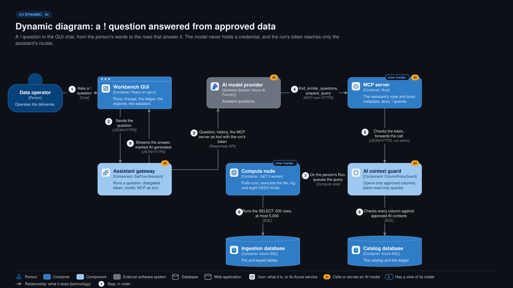

# Dynamic diagram: a ! question answered from approved data

<!-- Generated by tools/c4/render.py from osdu/docs/reference/architecture/c4-model.yaml. Edit the model and render again. -->

[Architecture diagrams](README.md) › [System context](system-context.md) › [Containers](containers.md) › [AI paths](ai-usage.md) › **A question answered** · Zoom in: [Compute node](compute-node.md), [MCP server](mcp-server.md)

A ! question in the GUI chat, from the person's words to the rows that answer it. The model never holds a credential, and the run's token reaches only the assistant's routes.

[Light version](svg/question-light.svg)

## The steps

| Step | From | To | What happens |
| --- | --- | --- | --- |
| 1 | Data operator | Workbench GUI | A person starts data mode with ! (or !data) and asks, for example !which wellbores have a gamma ray log?; follow-ups stay in data mode until !exit. (Chat) |
| 2 | Workbench GUI | Assistant gateway | The control plane delegates a token from the person for this run alone: their id, no admin or node scope, refused on every route not opened to the assistant. (JSON/HTTPS) |
| 3 | Assistant gateway | AI model provider | The gateway sends the model the MCP server's instructions, the last 20 messages and the question, with the MCP server as its tool and the run's token in the tool's header. (Responses API) |
| 4 | AI model provider | MCP server | The model calls the server's data-mode tools: stored questions close to this one, with the semantic layer to answer from, and prepare_query with the SQL it composed. (MCP over HTTPS) |
| 5 | MCP server | AI context guard | The server checks the bearer with GET /api/v1/me and forwards the call with it. (JSON/HTTPS, run token) |
| 6 | AI context guard | Catalog database | ColumnPolicyGuard refuses a column no approved context opens, and only one read-only SELECT is planned; the plan token is single-use and lives 15 minutes. (SQL) |
| 7 | AI context guard | Compute node | The GUI shows the query; the person's click on Run redeems the plan token (run_query). A saved answer a person confirmed may run without a click: 50 rows, 5 seconds. (Compute task) |
| 8 | Compute node | Ingestion database | A node runs the SELECT against the ingestion database and returns the rows to the control plane. (SQL) |
| 9 | Assistant gateway | Workbench GUI | The answer streams back marked with the model that wrote it; the conversation is kept in the catalog, and only the person's Yes, Not quite or No records a verdict. (JSON/HTTPS) |

## What the view shows

| Element | Kind | Technology | What it is | Reference |
| --- | --- | --- | --- | --- |
| Data operator | Person |  | Triggers and watches runs, follows a record from its source file and row to the OSDU id and version it landed as, releases, redelivers or removes records, reads assertion reports and asks the assistant. | [concepts/gui](../concepts/gui.md) |
| Workbench GUI | Container | React on nginx | SQLFlow's workbench with the module's pages registered through the GUI module contract: pipelines and runs, lineage, the ledger and its records, the explorer of what OSDU holds, assertions, dimensions, inventories, templates, caches and the chat assistant. A static single-page app served by nginx; it calls the control plane's API. | [concepts/gui](../concepts/gui.md) |
| Assistant gateway | Component (AI) | SqlFlow.Assistant | Runs each chat or Explain question under a token delegated from the person for that run alone (its timeout plus 60 seconds, no admin or node scope), sends the model the MCP server's instructions and the conversation with the MCP server as its tool, streams the answer and keeps the conversation. | [concepts/ai-features](../concepts/ai-features.md) |
| AI model provider | Software System (AI) | Azure AI Foundry | The chat model behind the GUI assistant and Explain: a Foundry deployment (gpt-5.1 in the shipped environments), or OpenAI or Anthropic by setting, plus an optional transcription deployment for voice. Off on a fresh deployment; no flow, mapping, render or delivery ever calls a model. | [concepts/ai-features](../concepts/ai-features.md) |
| [MCP server](mcp-server.md) | Container (AI) | Rust | osdu-delivery-mcp, a Model Context Protocol server: SQLFlow's server composed with the delivery module. Every assistant reads its instructions; it answers from metadata, and from data only for a ! question through a read-only query over what an approved AI context opens. It holds no credential: it forwards each caller's token. | [guides/mcp](../guides/mcp.md) |
| AI context guard | Component (AI) | ColumnPolicyGuard | Holds the AI contexts an administrator approved and the saved answers. prepare_query and run_query: one read-only SELECT over the columns the approved contexts open, checked on prepare and on run, redeemed by a single-use plan token that lives 15 minutes, run on a node as a compute task. | [guides/mcp](../guides/mcp.md) |
| [Compute node](compute-node.md) | Container | .NET 9 worker | SqlFlow.Delivery.Worker.Host: SQLFlow's worker with the module installed. It takes its work outbound from the control plane, so it can sit next to the data, and reads and writes the ledger in the osdu schema through the catalog's connection. | [cli/worker](../cli/worker.md) |
| Ingestion database | Container | Azure SQL | OsduData: the pre tables a file flow lands its files into, the keyed ingestion tables an ing flow upserts (stamping UpdatedDate_DW) and a delivery flow reads incrementally, and the tables dimension flows build. Snapshot isolation must be on. | [concepts/architecture](../concepts/architecture.md) |
| Catalog database | Container | Azure SQL | OsduDelivery: SQLFlow's catalog (pipelines, runs, schedules, lineage, users, conversations) and, beside it, the osdu schema with its own migrations: the ledger, the audit trail, cache versions, the index of the repository's templates, partitions and the central configuration. | [concepts/database](../concepts/database.md) |

## Notes

An editor's assistant takes the same path from step 4 on, with the person's own token instead of a delegated one, so
it can do what the person can do. Without `!` the conversation is in estate mode, and the model is sent metadata only:
the ledger's bookkeeping and the module's definitions, never a record's content or a source row.

---

Previous: [A record delivered](record-delivery.md) · [Architecture diagrams](README.md) · Next: [A commit synced](git-integration.md)
