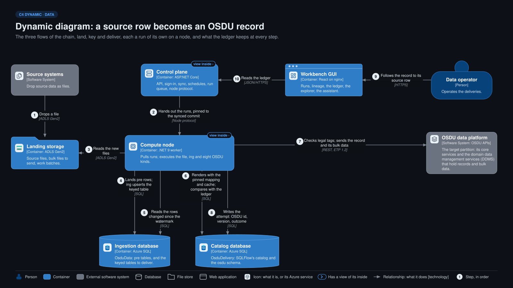

# Dynamic diagram: a source row becomes an OSDU record

<!-- Generated by tools/c4/render.py from osdu/docs/reference/architecture/c4-model.yaml. Edit the model and render again. -->

[Architecture diagrams](README.md) › [System context](system-context.md) › [Containers](containers.md) › **A record delivered** · Zoom in: [Control plane](control-plane.md), [Compute node](compute-node.md)

The three flows of the chain, land, key and deliver, each a run of its own on a node, and what the ledger keeps at every step.

[Light version](svg/record-delivery-light.svg)

## The steps

| Step | From | To | What happens |
| --- | --- | --- | --- |
| 1 | Source systems | Landing storage | A source system drops a file into the landing storage, under the folder a file flow reads. (ADLS Gen2) |
| 2 | Control plane | Compute node | A schedule fires (or a person triggers) the pipeline; the control plane queues its runs in lineage order, each pinned to the commit last synced, and a node takes the file flow's run. (Node protocol) |
| 3 | Compute node | Landing storage | The file flow reads the new files from the landing storage. (ADLS Gen2) |
| 4 | Compute node | Ingestion database | It lands them into the pre table as text with FileName_DW and RowNumber_DW; the ing flow, a run of its own, upserts the typed view into the keyed ingestion table and stamps UpdatedDate_DW. (SQL) |
| 5 | Compute node | Ingestion database | The delivery flow's run reads the rows (and child rows) whose UpdatedDate_DW moved since its last run, under snapshot isolation. (SQL) |
| 6 | Compute node | Catalog database | Each row renders through the pinned mapping, its template and the partition's cache version read from the catalog; its hash is compared with what the ledger last delivered, and only what renders differently is planned. (SQL) |
| 7 | Compute node | OSDU data platform | The route checks the legal tags, then sends the record (and its files or bulk data) to OSDU under its deterministic id, retrying what may succeed later. (REST, ETP 1.2) |
| 8 | Compute node | Catalog database | Every try is one append-only attempt in the ledger: the document hash it sent, what each step answered, the OSDU id and version, the outcome and any error. (SQL) |
| 9 | Data operator | Workbench GUI | An operator finds the record by key, OSDU id or source file, and the ledger shows its source file and row, the mapping and cache version that rendered it, every attempt and every action taken. (HTTPS) |
| 10 | Workbench GUI | Control plane | The GUI reads it through the delivery API; every count it shows is counted from the ledger's records. (JSON/HTTPS) |

## What the view shows

| Element | Kind | Technology | What it is | Reference |
| --- | --- | --- | --- | --- |
| Source systems | Software System |  | Where the data starts. Upstream applications and jobs drop files (CSV, JSON, Parquet, LAS and others) into the landing storage, or hold the data in a database a flow reads. | [guides/getting-started](../guides/getting-started.md) |
| Landing storage | Container | ADLS Gen2 | A storage account with a hierarchical namespace and shared keys off, container landing. Every run is given its location as LANDING_URL (abfss://landing@&lt;account&gt;.dfs.core.windows.net): the source files the file flows land, the bulk payload files deliveries send, and work batch files when a flow writes them there. | [guides/deployment](../guides/deployment.md) |
| [Control plane](control-plane.md) | Container | ASP.NET Core | SQLFlow's control plane (.NET 9) with DeliveryControlPlaneModule: the REST API (the delivery API under /api/v1/delivery), identity and tokens, the managed git sync, schedules, the run queue and dispatcher, the node protocol, the chat assistant, and the module's background services. It decides what runs and owns the state; it runs no flow itself. | [concepts/control-plane](../concepts/control-plane.md) |
| [Compute node](compute-node.md) | Container | .NET 9 worker | SqlFlow.Delivery.Worker.Host: SQLFlow's worker with the module installed. It takes its work outbound from the control plane, so it can sit next to the data, and reads and writes the ledger in the osdu schema through the catalog's connection. | [cli/worker](../cli/worker.md) |
| Ingestion database | Container | Azure SQL | OsduData: the pre tables a file flow lands its files into, the keyed ingestion tables an ing flow upserts (stamping UpdatedDate_DW) and a delivery flow reads incrementally, and the tables dimension flows build. Snapshot isolation must be on. | [concepts/architecture](../concepts/architecture.md) |
| Catalog database | Container | Azure SQL | OsduDelivery: SQLFlow's catalog (pipelines, runs, schedules, lineage, users, conversations) and, beside it, the osdu schema with its own migrations: the ledger, the audit trail, cache versions, the index of the repository's templates, partitions and the central configuration. | [concepts/database](../concepts/database.md) |
| OSDU data platform | Software System | OSDU APIs | A data partition's core services (Storage, Search, Schema, Legal, File, Dataset, Workflow, Entitlements) and its domain data management services (Wellbore, Reservoir over ETP, Production), which hold the delivered records and their bulk data. | [concepts/protocols](../concepts/protocols.md) |
| Workbench GUI | Container | React on nginx | SQLFlow's workbench with the module's pages registered through the GUI module contract: pipelines and runs, lineage, the ledger and its records, the explorer of what OSDU holds, assertions, dimensions, inventories, templates, caches and the chat assistant. A static single-page app served by nginx; it calls the control plane's API. | [concepts/gui](../concepts/gui.md) |
| Data operator | Person |  | Triggers and watches runs, follows a record from its source file and row to the OSDU id and version it landed as, releases, redelivers or removes records, reads assertion reports and asks the assistant. | [concepts/gui](../concepts/gui.md) |

## Notes

Steps 2 to 8 are three runs of three flows (`-01-pre`, `-02-ing`, `-03-delivery`), each with its own log and failure,
ordered by lineage. A delivery run plans into a submission and work batches, then drains them under leases; a large
one fans out a part per 1,000 rows on up to eight nodes. `plan` stops after step 6; `verify` reads delivered records
back and records `match`, `drifted` or `missing` ([submissions](../concepts/submissions.md)).

---

Previous: [MCP server](mcp-server.md) · [Architecture diagrams](README.md) · Next: [A question answered](question.md)
