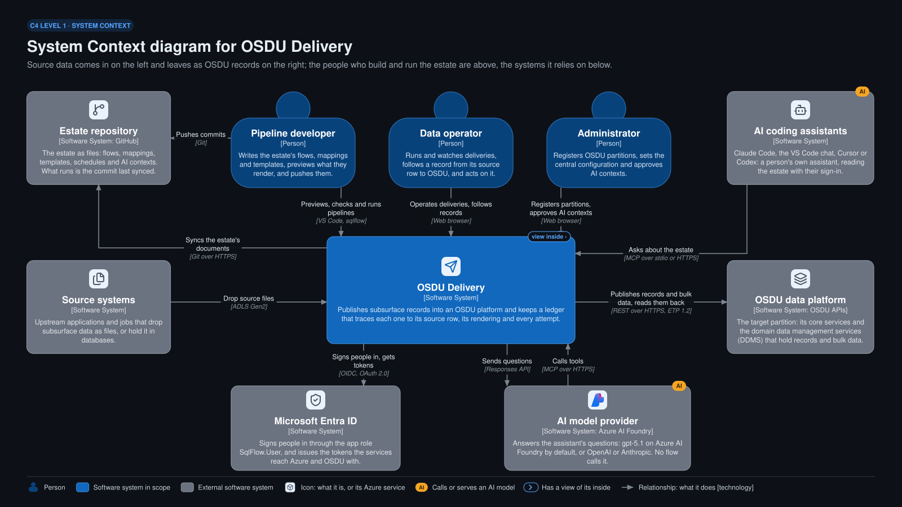

# System Context diagram for OSDU Delivery

<!-- Generated by tools/c4/render.py from osdu/docs/reference/architecture/c4-model.yaml. Edit the model and render again. -->

[Architecture diagrams](README.md) › **System context** · Zoom in: [Containers](containers.md)

Source data comes in on the left and leaves as OSDU records on the right; the people who build and run the estate are above, the systems it relies on below.

[Light version](svg/system-context-light.svg)

## What the view shows

| Element | Kind | Technology | What it is | Reference |
| --- | --- | --- | --- | --- |
| Estate repository | Software System | GitHub | The estate as YAML and JSON files in git: flows, mappings, templates, cache definitions, schedules, assertions and AI contexts. A run executes the commit the control plane last synced, never a working copy. | [flow/repository](../flow/repository.md) |
| Pipeline developer | Person |  | Writes the estate's flows, mappings, templates, schedules, assertions and AI contexts in VS Code, checks and previews them against the synced estate, and pushes them to the estate repository. | [guides/vscode](../guides/vscode.md) |
| Data operator | Person |  | Triggers and watches runs, follows a record from its source file and row to the OSDU id and version it landed as, releases, redelivers or removes records, reads assertion reports and asks the assistant. | [concepts/gui](../concepts/gui.md) |
| Administrator | Person |  | Registers and describes OSDU partitions, sets the central configuration every run resolves with, approves AI contexts, manages users and sets retention on the Maintenance page. | [concepts/authentication-and-identity](../concepts/authentication-and-identity.md) |
| AI coding assistants | Software System (AI) |  | An assistant a person runs (Claude Code, the VS Code chat, Cursor, Codex). It calls the MCP server with the person's own token, so it can do what that person can do, and what it does is recorded as theirs. | [guides/mcp](../guides/mcp.md) |
| Source systems | Software System |  | Where the data starts. Upstream applications and jobs drop files (CSV, JSON, Parquet, LAS and others) into the landing storage, or hold the data in a database a flow reads. | [guides/getting-started](../guides/getting-started.md) |
| [OSDU Delivery](containers.md) | Software System |  | SQLFlow with the OSDU module installed: SQLFlow lands and keys the source data; the module renders each row through its mapping, delivers it to OSDU and keeps the ledger, from which every delivered record can be reconstructed. | [concepts/overview](../concepts/overview.md) |
| OSDU data platform | Software System | OSDU APIs | A data partition's core services (Storage, Search, Schema, Legal, File, Dataset, Workflow, Entitlements) and its domain data management services (Wellbore, Reservoir over ETP, Production), which hold the delivered records and their bulk data. | [concepts/protocols](../concepts/protocols.md) |
| Microsoft Entra ID | Software System |  | Signs people in to the GUI, the editor and the command line (OpenID Connect) through the app registration's one role, SqlFlow.User, with assignment required, and issues the managed identity and client-credential tokens (OAuth 2.0) the services use for Azure and OSDU. | [concepts/authentication-and-identity](../concepts/authentication-and-identity.md) |
| AI model provider | Software System (AI) | Azure AI Foundry | The chat model behind the GUI assistant and Explain: a Foundry deployment (gpt-5.1 in the shipped environments), or OpenAI or Anthropic by setting, plus an optional transcription deployment for voice. Off on a fresh deployment; no flow, mapping, render or delivery ever calls a model. | [concepts/ai-features](../concepts/ai-features.md) |

## How they connect

| From | To | What | Technology |
| --- | --- | --- | --- |
| Pipeline developer | Estate repository | Pushes commits | Git |
| Pipeline developer | OSDU Delivery | Previews, checks and runs pipelines | VS Code, sqlflow |
| Data operator | OSDU Delivery | Operates deliveries, follows records | Web browser |
| Administrator | OSDU Delivery | Registers partitions, approves AI contexts | Web browser |
| OSDU Delivery | Estate repository | Syncs the estate's documents | Git over HTTPS |
| Source systems | OSDU Delivery | Drop source files | ADLS Gen2 |
| OSDU Delivery | OSDU data platform | Publishes records and bulk data, reads them back | REST over HTTPS, ETP 1.2 |
| AI coding assistants | OSDU Delivery | Asks about the estate | MCP over stdio or HTTPS |
| OSDU Delivery | Microsoft Entra ID | Signs people in, gets tokens | OIDC, OAuth 2.0 |
| OSDU Delivery | AI model provider | Sends questions | Responses API |
| AI model provider | OSDU Delivery | Calls tools | MCP over HTTPS |

## Notes

The relationships name what crosses the boundary, not every call: the [containers view](containers.md) shows which part
of OSDU Delivery makes each one. The AI model provider is off on a fresh deployment, and no flow, mapping, render or
delivery calls it ([AI in OSDU Delivery](../concepts/ai-features.md)).

---

[Architecture diagrams](README.md) · Next: [Containers](containers.md)
